<a href="https://hesabak.hatemsoliman.dev">
  <picture>
    <source media="(prefers-color-scheme: dark)" srcset="docs/readme/banner-dark.png">
    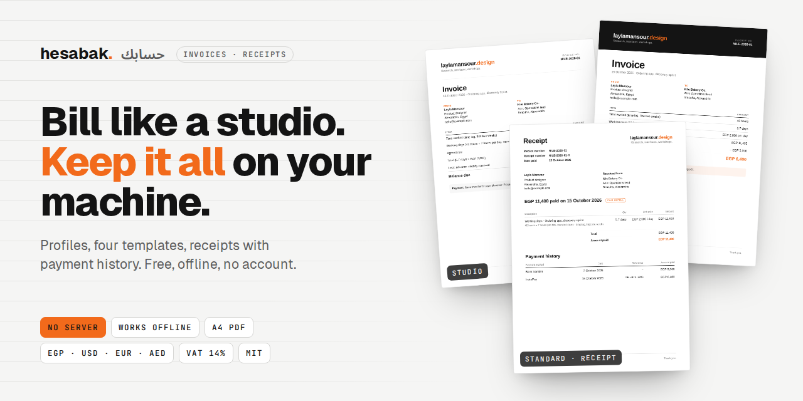
  </picture>
</a>

<p align="center">
  <a href="https://hesabak.hatemsoliman.dev"><b>Open the app</b></a> ·
  <a href="#run-it-locally">Run it locally</a> ·
  <a href="#deploy-your-own">Deploy your own</a> ·
  <a href="#your-data">Your data</a>
</p>

<p align="center">
  
  
  
  
  
  
  
</p>

<br>

<p align="center">
  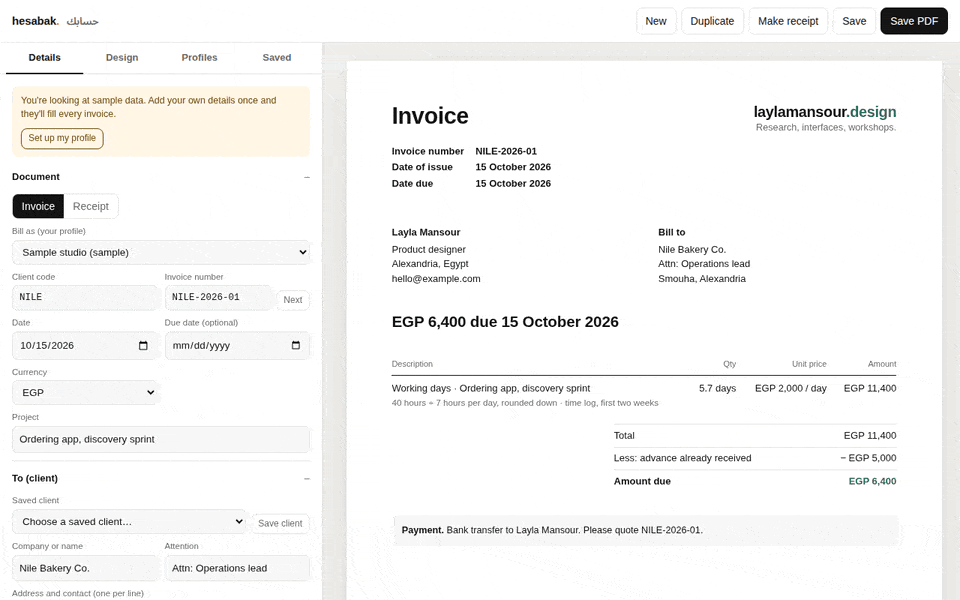
</p>
<p align="center"><sub><b>Make it yours in a minute.</b> Type your details once; every invoice after that already has them. Real-time capture.</sub></p>

<br>

## The trailer

**Hesabak** (حسابك, Egyptian Arabic for "your bill") is an invoice and receipt maker for freelancers and
small studios. It looks like the invoices big platforms send, prints to a clean one-page A4 PDF, and
keeps everything in your own browser. There is no account, no server and no subscription. Open the
page, bill your client, save the PDF.

<table>
  <tr>
    <td width="50%" valign="top">
      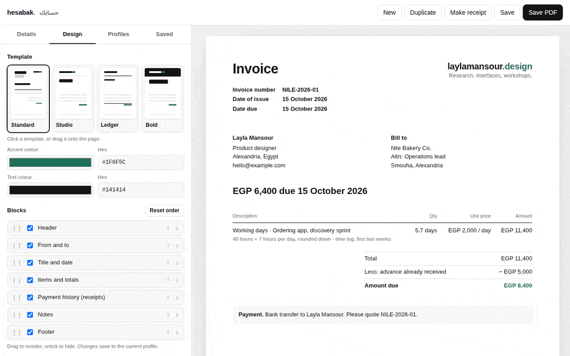
      <p><b>Four templates, any colour.</b> Standard, Studio, Ledger and Bold. Pick an accent and a text colour; the page updates as you click.</p>
    </td>
    <td width="50%" valign="top">
      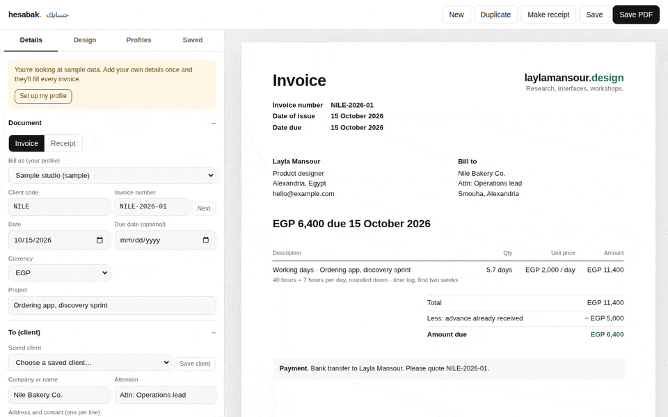
      <p><b>Invoice, then receipt.</b> One click turns an invoice into its receipt, with a payment history and a "Paid in full" stamp once the balance hits zero.</p>
    </td>
  </tr>
  <tr>
    <td width="50%" valign="top">
      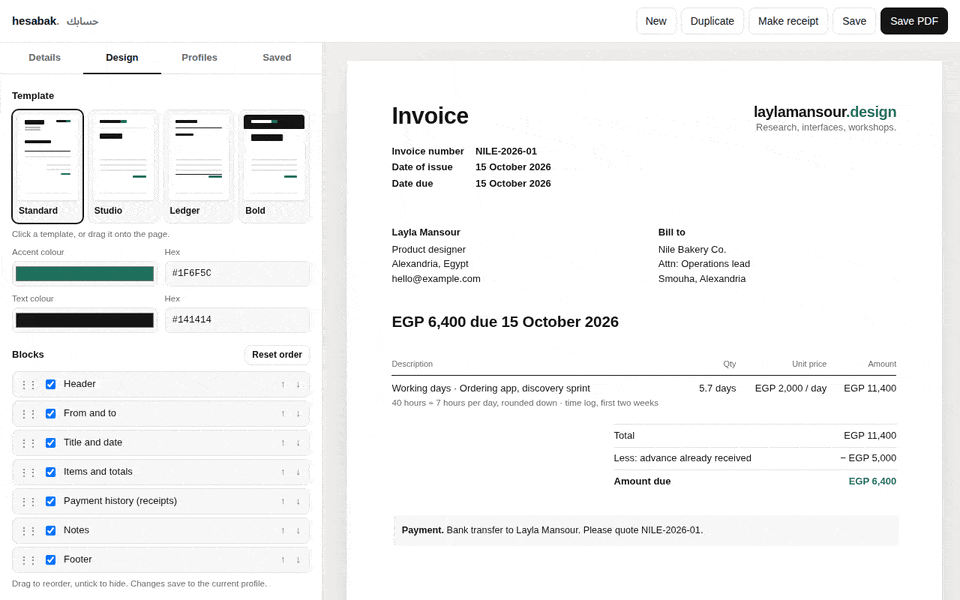
      <p><b>Blocks and placeholders.</b> Reorder or hide parts of the page. Drop <code>{client}</code>, <code>{invoice}</code> or <code>{balance}</code> into any note and they fill themselves in.</p>
    </td>
    <td width="50%" valign="top">
      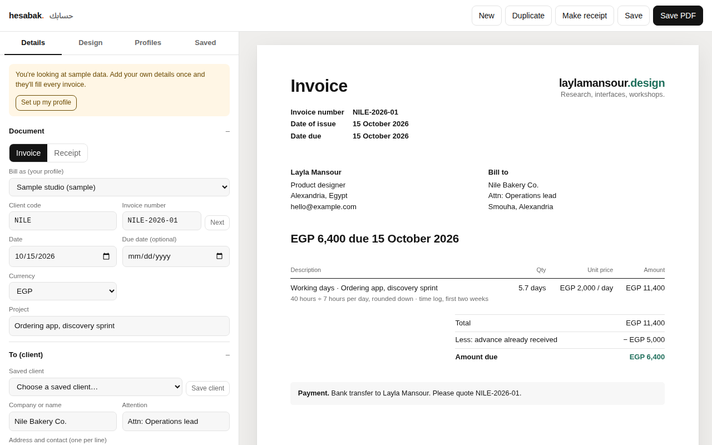
      <p><b>What you see is the PDF.</b> The page on the right is the page that prints. If it stops fitting on one A4 sheet, the app tells you.</p>
    </td>
  </tr>
</table>

<details>
<summary><b>Contents</b></summary>

- [What it does](#what-it-does)
- [The templates](#the-templates)
- [How billing works](#how-billing-works)
- [Your data](#your-data)
- [How it's built](#how-its-built)
- [Run it locally](#run-it-locally)
- [Deploy your own](#deploy-your-own)
- [Project structure](#project-structure)
- [Regenerating the README media](#regenerating-the-readme-media)
- [Roadmap](#roadmap)
- [Licence and credits](#licence-and-credits)

</details>

## What it does

| | |
|---|---|
| **Profiles** | Each profile is one identity you bill as: your name, role, email, phone, address, wordmark, colours, layout and default payment note. Keep one per brand and switch with **Bill as**. |
| **Clients** | Save a client once, pick them from a list next time. A client code such as `ACME` gives numbers like `ACME-2026-01`, and **Next** finds the next free one. |
| **Two ways to bill** | Day rate from hours (hours ÷ hours per day, rounded down to a tenth of a day), or line items with quantity and unit price. |
| **Tax** | None, Egypt VAT 14%, or your own label and rate, either included in the price or added on top. |
| **Receipts** | **Make receipt** saves the invoice and creates its receipt: amount paid, payment method, date and reference for every payment. |
| **Delivery seal** | An optional delivery receipt number, such as the SHA-256 of what you handed over, printed in a small box with a plain-language note. Handy for audits and fixed-scope work. |
| **Payment link** | An optional "Pay online" link, for an InstaPay or payment page, under the amount due. |
| **PDF** | **Save PDF** prints one A4 page, named after the invoice number. |
| **Offline** | Install it from the browser like an app. It keeps working with no connection. |

## The templates

The same invoice in all four. The **Standard** layout follows the invoices and receipts that payment
platforms send; the others are for when you want more character.

<table>
  <tr>
    <td width="25%">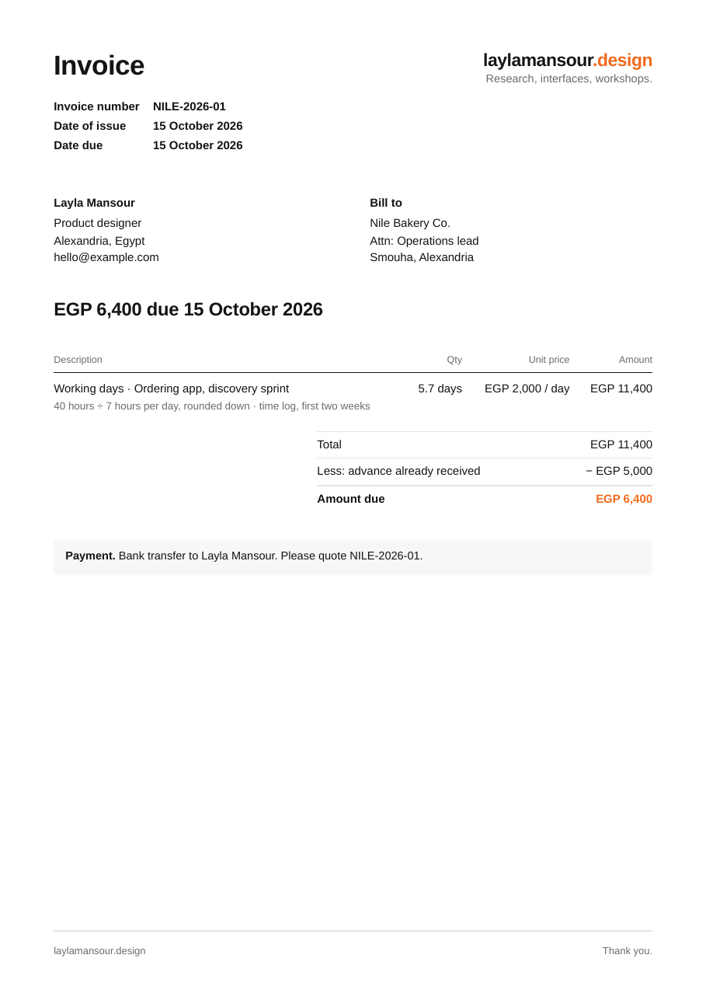<p align="center"><sub><b>Standard</b></sub></p></td>
    <td width="25%">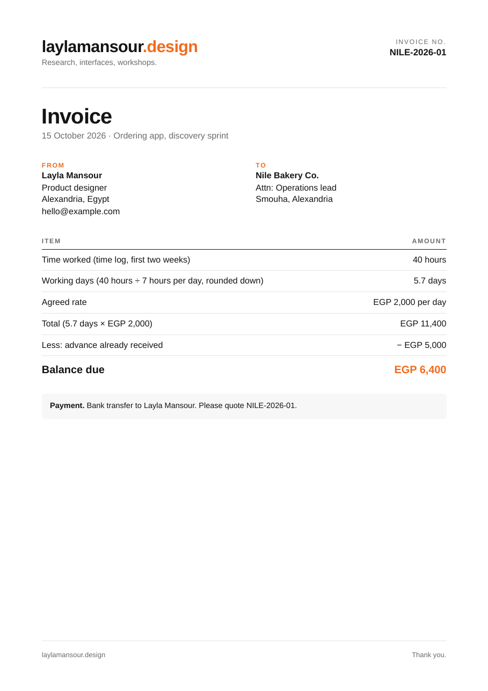<p align="center"><sub><b>Studio</b></sub></p></td>
    <td width="25%">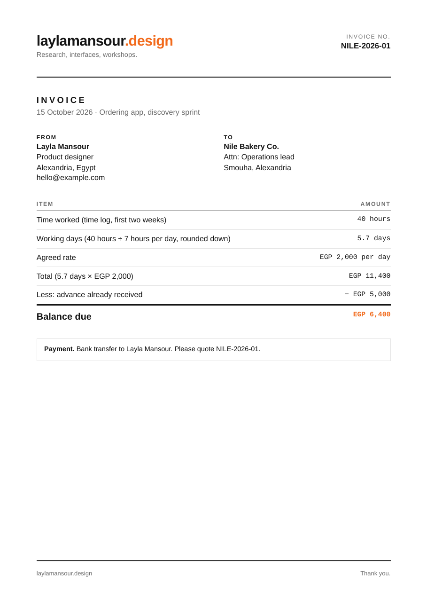<p align="center"><sub><b>Ledger</b></sub></p></td>
    <td width="25%">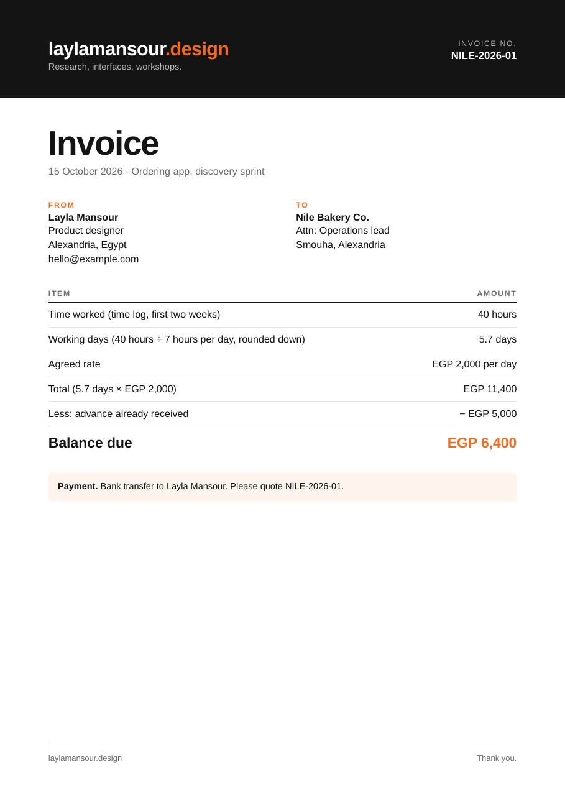<p align="center"><sub><b>Bold</b></sub></p></td>
  </tr>
</table>

And the receipt, in Standard and Studio:

<table>
  <tr>
    <td width="50%">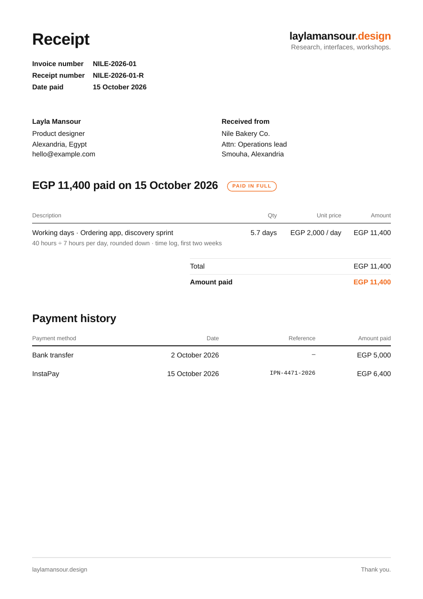</td>
    <td width="50%">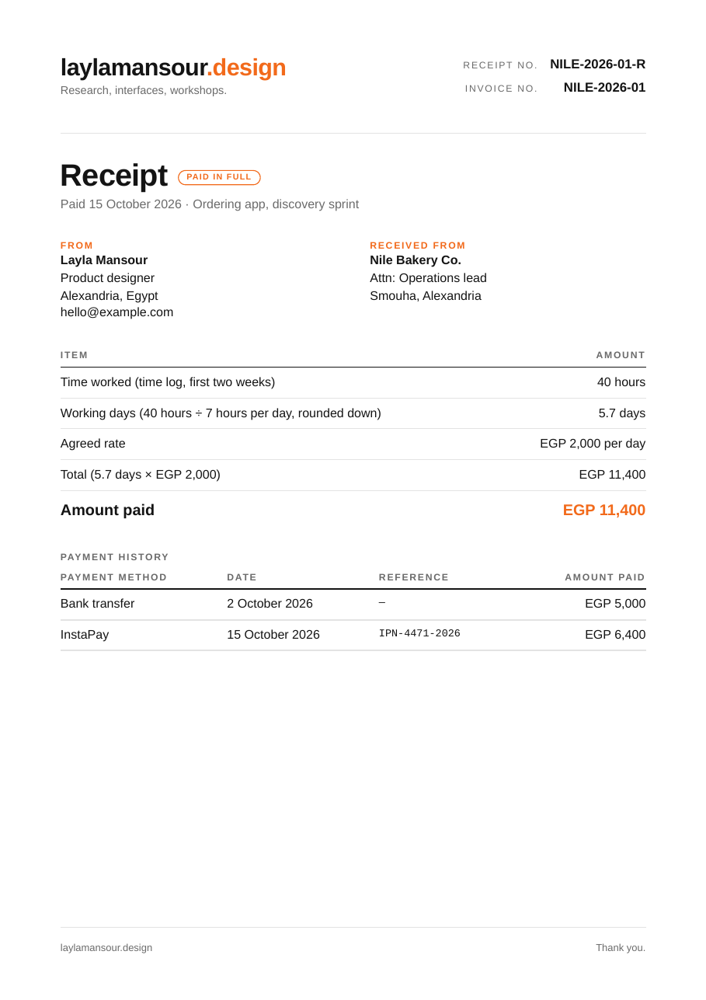</td>
  </tr>
</table>

## How billing works

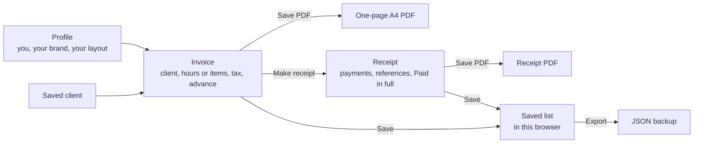

A worked example with the day rate: **40 hours ÷ 7 hours per day = 5.71**, rounded down to **5.7 days**.
At **EGP 2,000** a day that's **EGP 11,400**. Less an advance of **EGP 5,000**, the balance due is
**EGP 6,400**. Rounding down is deliberate: the client never pays for a fraction of a day you didn't work.

An **invoice** asks to be paid. A **receipt** confirms you were. Send the invoice when the work is
delivered; send the receipt once the money arrives.

## Your data

Everything stays in the browser you use: profiles, clients and every saved invoice. Nothing is sent
anywhere, and the app has no server to send it to. The `vercel.json` content security policy also stops the
page from connecting to any other site.

That also means:

- **Back up now and then.** **Saved → Export everything** downloads one JSON file. **Import JSON** brings it back, on the same or another computer.
- **Clearing site data erases it.** So does a private window when you close it.
- **One browser, one copy.** Chrome and Safari on the same laptop keep separate copies.

The app opens with a fictional sample (Layla Mansour, Nile Bakery Co.) until you set up your own
profile. No real person's data is in this repository, and personal exports are git-ignored.

## How it's built

One HTML file with inline CSS and JavaScript. No framework, no dependencies, no build step.

| Piece | How |
|---|---|
| Page | `index.html`: editor, live A4 sheet, all logic |
| Print | CSS `@page { size: A4; margin: 0 }`, so the browser's own PDF engine draws exactly what you see |
| Storage | `localStorage`, one key, versioned, with migration from older formats |
| Offline | `sw.js`, network-first with a cache fallback |
| Install | `manifest.webmanifest` and icons |
| Security | `vercel.json`: strict CSP, `connect-src 'self'`, no referrer, no framing |

## Run it locally

Any static file server works. With Node installed:

```bash
git clone https://github.com/CodeNKoffee/hesabak.git
cd hesabak
npx serve .
```

Then open the address it prints. Opening `index.html` directly also works, but install and offline
need a real `http://` address.

## Deploy your own

It's free on Vercel, Netlify, Cloudflare Pages or GitHub Pages: there is nothing to build.

1. Fork this repository.
2. In Vercel: **Add New → Project**, import the fork, keep every default, **Deploy**.
3. Optional: under **Domains**, add your own (for example `invoices.yourname.com`), then add the CNAME record your DNS provider asks for.

When you change any file, bump `VERSION` in `sw.js` so installed copies fetch the update.

## Project structure

```
hesabak/
├── index.html              the whole app
├── sw.js                   offline cache
├── manifest.webmanifest    install metadata
├── icon.svg, icon-*.png    app icons
├── vercel.json             security headers
├── docs/readme/            banner, GIFs and screenshots for this README
└── scripts/                README media recorder (not part of the app)
    ├── readme-media.mjs
    └── readme/             banner layout and its fonts (OFL)
```

## Regenerating the README media

Every GIF and screenshot here is recorded from the real app with the fictional sample, so the README
can't drift from the product. You need Node, `ffmpeg` and `gifsicle`.

```bash
cd scripts
npm install
npx playwright install chromium
npm run media                 # everything
npm run media -- receipt      # one scene: templates, profile, receipt, blocks, stills
```

## Roadmap

- Arabic interface and right-to-left invoices
- Logo upload alongside the text wordmark
- Recurring invoices and payment reminders
- Optional encrypted sync between your own devices
- More currencies and per-client tax defaults

## Licence and credits

Code under the [MIT licence](LICENSE). The banner uses Geist, JetBrains Mono and Noto Sans Arabic,
all under the SIL Open Font License; their licences are in `scripts/readme/fonts/`.

Built by [Hatem Soliman](https://hatemsoliman.dev).
